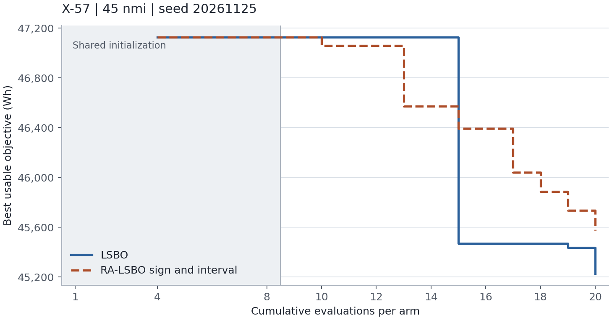

# X-57 engineering comparison v2

Code `7d106a807559a564d4b4065a935fb8abe8b7e265`, mission 45 nmi, seed `20261125`. The run freezes eight initial designs with four per layout and shares their ordered results across the three arms. Each arm may make up to 12 online calls. The physical limit is 44 calls and the worker concurrency limit is 12. All four thread settings are fixed at one.

## Checks before RCAIDE

- `offline_report.json` contains 12 matched historical calls at 50 nmi and 20 at 55 nmi. It records the fixed candidate pool, both rankings and the per-call evidence alignment. The SHA256 is `9585e86cbe46629e48b156ca57f0011a4176ef0ab1b169c51b10676db9cc7360`.
- The full-budget mock in `mock_report.json` settled 44 subprocess calls. It charged the eight initial calls once and 12 calls per arm for online evaluation. Both RA arms fitted the same synthetic partial observation, using a violation sign and a numeric lower bound respectively.
- Both protocol tests passed, including the matched mock and a fixture that exercises the native consecutive-missing-objective stop.

## RCAIDE results

The eight shared initial calls produced one usable design, at position 4, with an objective of 47,127.11 Wh. All 44 physical calls settled with exact objectives. Of those calls, 34 returned usable designs and 10 completed with constraint violations. The exit code was 0, elapsed time was 51 min 51 s, and peak concurrency was eight workers.

| Arm | First usable online call | Usable online calls | First online improvement of the shared best | Best usable energy at 20 calls | Partial observations fitted |
| --- | ---: | ---: | ---: | ---: | ---: |
| LSBO | 1 | 9 | 7 | 45,228.20 Wh | 0 |
| RA-LSBO sign | 1 | 12 | 2 | 45,572.33 Wh | 0 |
| RA-LSBO interval | 1 | 12 | 2 | 45,572.33 Wh | 0 |

Each RA arm made two proposals with completion-stage ranking and ten with performance-stage search. It used exact energy observations in all 12 fits. The arms matched at 12 of 12 online candidate positions, and both trajectories overlap. The native LSBO arm finished 344.12 Wh lower. The run assesses the one-usable-design initialization and later performance search for this seed. An online estimate of the interval increment requires verified lower bounds and independent outcomes.

The ledger recorded zero posterior fallbacks, native recovery or exploration bypasses in the RA arms, and native missing-objective stops. The local acquisition optimizer emitted line-search warnings, retained in `pilot.stderr.log`.

`trajectory.json` contains exact per-evaluation values, candidate IDs, and fallback records. `pilot_report.json` contains the run's own report. The merged `calls.jsonl` and individual journals record each physical launch and settlement, including the two separate paid trajectories for the RA arms. The worker directories contain the archived requests, responses, solver logs, and energy audits.

## Reproduction

Use the interpreter and four frozen input paths in the [previous PowerShell reproduction script](https://github.com/Luyi1235/RA-LSBO/blob/613983af769de05ce7ca8a15a7c0be7bd38963aa/results/x57-engineering-energy-pilot-07a95dec/reproduce.ps1). At the code commit above, run `offline` with those inputs and a fresh output directory. Run the mock and real `pilot` commands with `--seed 20261125 --workers 12 --online 12`. The real command takes `--execute-rcaide --offline-report $proof --offline-report-sha256 $proofHash`, using the offline report from this same checkout and its computed SHA256.

Run `python summarize_pilot.py .` in this archive to verify the ledger and regenerate the trajectory JSON. The figure is generated with `python plot_trajectory.py trajectory.json best_usable_trajectory.png`.
