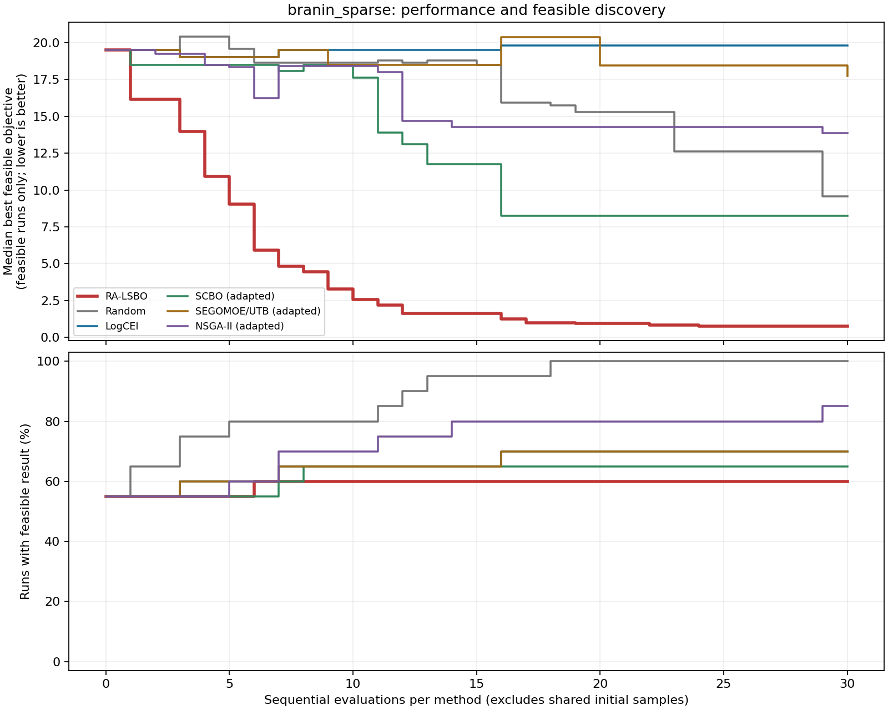
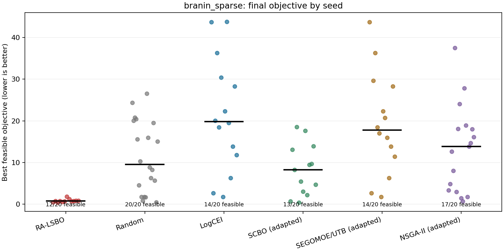
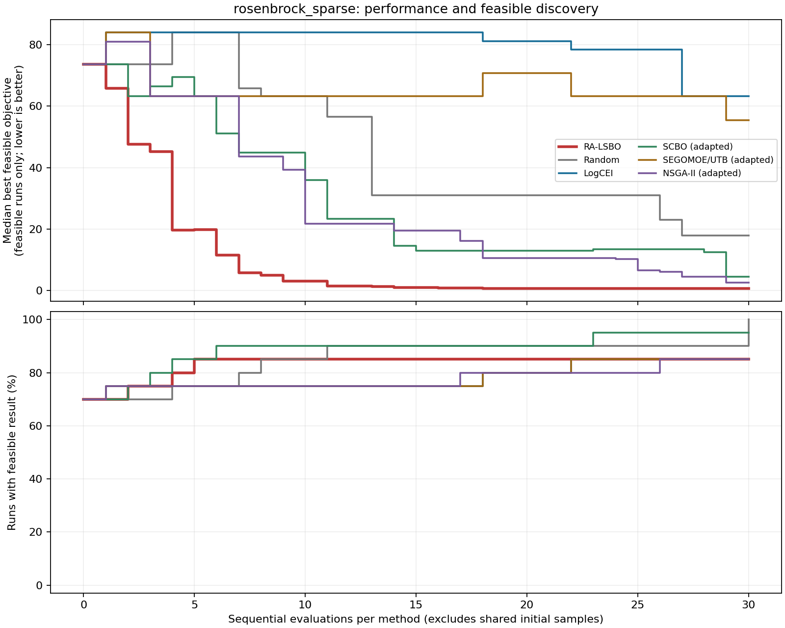
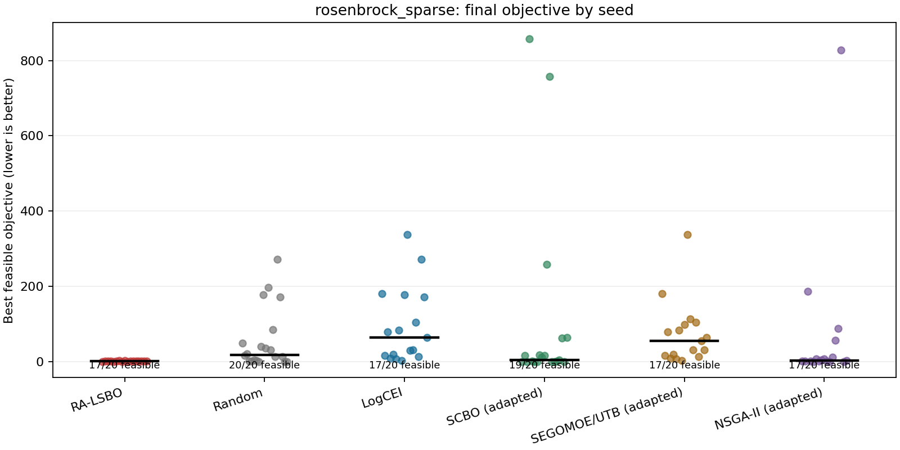

# External Algorithm Comparison

Suite: mathematical; profile: pilot; calls: 7716/7716.
Exploratory screening only; adapters are not reference-code reproductions. No RCAIDE MDA calls.

| Case | Method | Runs | Feasible runs | Median feasible objective |
|---|---|---:|---:|---:|
| branin_sparse | logcei | 20 | 14 | 19.8036 |
| branin_sparse | nsga2_adapted | 20 | 17 | 13.8698 |
| branin_sparse | ra_lsbo | 20 | 12 | 0.764459 |
| branin_sparse | random | 20 | 20 | 9.56179 |
| branin_sparse | scbo_adapted | 20 | 13 | 8.25694 |
| branin_sparse | sego_utb_adapted | 20 | 14 | 17.7594 |
| rosenbrock_sparse | logcei | 20 | 17 | 63.2847 |
| rosenbrock_sparse | nsga2_adapted | 20 | 17 | 2.50799 |
| rosenbrock_sparse | ra_lsbo | 20 | 17 | 0.667858 |
| rosenbrock_sparse | random | 20 | 20 | 17.9601 |
| rosenbrock_sparse | scbo_adapted | 20 | 19 | 4.49842 |
| rosenbrock_sparse | sego_utb_adapted | 20 | 17 | 55.4509 |

Unknown and failed outcomes are retained. Conditional objective summaries are shown with feasible-run counts; use `results.json` for paired outcomes and full trajectories.

## Figures

Convergence medians and final objectives condition on runs with a feasible solution; the feasible-run fraction and counts are shown separately. SOC risk bounds reflect unknown outcomes, are conditional on an available incumbent, and are not confidence intervals or flight certification.

